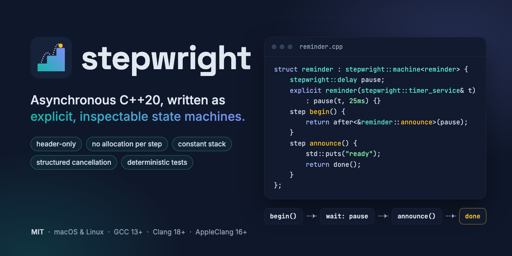
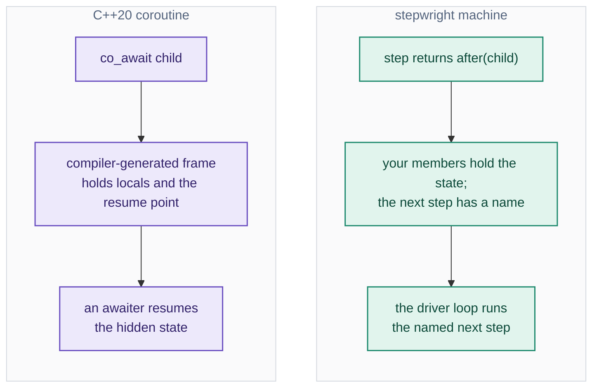

# stepwright



[](https://github.com/stepwright/stepwright/actions/workflows/linux.yml)
[](https://github.com/stepwright/stepwright/actions/workflows/macos.yml)
[](https://github.com/stepwright/stepwright/actions/workflows/quality.yml)
[](https://github.com/stepwright/stepwright/releases)
[](LICENSE)

[](https://github.com/stepwright/stepwright#install)
[](https://github.com/stepwright/stepwright#install)
[](https://github.com/stepwright/stepwright#supported-platforms)
[](https://github.com/stepwright/stepwright#supported-platforms)
[](https://github.com/stepwright/stepwright#supported-platforms)

**Write asynchronous operations as explicit, inspectable C++20 state machines —
without heap allocation per step or wait.** Header-only and MIT-licensed, for
macOS and Linux.

- **See where every operation is.** Each wait is a named step; state lives in
  ordinary members you can inspect in a debugger.
- **No hidden costs.** No allocation per step or wait, and a constant stack
  depth, even across millions of steps.
- **Test concurrency deterministically.** Virtual time and a seeded executor
  replay thread interleavings without sleeps.

## Quick look

An operation is a class. Each step returns what should happen next; a small
driver loop does it:

```cpp
#include <stepwright/stepwright.hpp>
#include <chrono>
#include <cstdio>
struct reminder : stepwright::machine<reminder> {
    stepwright::delay pause;
    explicit reminder(stepwright::timer_service& timers)
        : pause(timers, std::chrono::milliseconds(25)) {}
    step begin() { return after<&reminder::announce>(pause); }
    step announce() { std::puts("ready"); return done(); }
};
int main() {
    stepwright::testing::virtual_executor clock;
    reminder op(clock);
    return clock.run(op) ? 1 : 0;
}
```

Build it with `c++ -std=c++20 -pthread -Iinclude demo.cpp -o demo`. Virtual time
makes this demo instant; with real timers, use a `steady_timer_service` and
`sync_wait(op)` from `main` (never from a step or a pool worker).

## How it works


1. **Your code starts a machine** with a completion and an optional cancel token:
   `start`, `sync_wait` or `virtual_executor::run`.
2. **Each step is an ordinary member function** that returns a transition:
   `then`, `after(child)`, `forward(child)`, `park`, `defer`, `done` or `fail`.
3. **The driver loop carries the transition out.** A child that completes at once
   is picked up in the same loop: no recursion, no allocation.
4. **A child that completes later**, on any thread, resumes the machine. If the
   machine is bound to a home executor and the completion arrives on another
   thread, the machine is posted there instead.
5. **`done()` or `fail(e)` delivers the result exactly once.** The machine can then
   be started again or destroyed.


Each diagram's [interactive version](docs/diagrams/README.md) links every part
to the code that implements it.

## Why stepwright?



| Approach | Prefer it when… | What stepwright trades |
|---|---|---|
| C++20 coroutines | You want natural sequential syntax and compatible awaiters. Visible child frames may be elided and be faster. | Named steps and member-owned state make storage and lifetime explicit, but take more code. No coroutine support or frame elision is required. |
| Senders/receivers | You need a general execution and composition vocabulary and its ecosystem. | A smaller model with one task protocol, not a P2300 implementation or adapter. |
| Callbacks | Your operation is small and ownership is already clear. | A driver loop, consistent cancellation and errors instead of ad hoc chains; some bookkeeping over a bare call. |

Zero-allocation claims concern successful **steps and waits**, not everything a
program does: pools, source state, join storage and buffers allocate at
construction; errors, diagnostics, callable convenience posts and unbounded buffer
growth can allocate. See [performance guidance](docs/guide.md#performance-guidance).

## Features at a glance

| Engine | Composition | Streams |
|---|---|---|
| `machine<D>` with named steps<br>`then` · `after` · `forward` · `park` · `defer`<br>errors as values with context<br>structured cancellation | `when_all` · `when_any` (also over containers)<br>`sequence` · `retry` with backoff<br>`delay` · `with_deadline`<br>`event` · `shared_task` · `async_mutex` | pull-based `source<T>`<br>`source_machine` producers<br>bounded `channel` · fair `merge`<br>`broadcast` · `for_each` |
| **Runtime** | **Testing** | **Debugging** |
| work-stealing `thread_pool`<br>steady and manual timers<br>`sync_wait` for `main` | `virtual_executor` with virtual time<br>`virtual_executor::run(op)`<br>seeded interleaving replay | opt-in live task registry<br>`dump()` shows where each task waits<br>errors name the machines they passed |

## Learn by example

Seven [side-by-side programs](examples/learn/README.md) solve familiar problems
both with plain C++ and with stepwright, check that both agree, and say when the
plain way is better:

| Program | What it shows |
|---|---|
| [factorial](examples/learn/factorial.cpp) | A long computation that shares one thread fairly and stops on request |
| [fibonacci](examples/learn/fibonacci.cpp) | A lazy, unbounded stream with backpressure |
| [merge_sort](examples/learn/merge_sort.cpp) | Bounded parallelism with no allocation while sorting |
| [parallel_sum](examples/learn/parallel_sum.cpp) | Map-reduce where one failing chunk cancels the rest |
| [deep_recursion](examples/learn/deep_recursion.cpp) | Ten million chained child operations in constant stack |
| [retry_download](examples/learn/retry_download.cpp) | Retry with backoff, tested instantly in virtual time |
| [timeout_computation](examples/learn/timeout_computation.cpp) | A time budget for CPU work |

Then read the [ten numbered examples](examples/README.md): timers, thread pools,
cancellation, backpressure and deterministic race replay.

## Install

CMake 3.21 or newer is needed for CMake integration; the library itself needs
only C++20 and threads. Developer dependencies are never fetched for consumers.

<details>
<summary><b>FetchContent</b> (recommended)</summary>

```cmake
include(FetchContent)
FetchContent_Declare(stepwright
    GIT_REPOSITORY https://github.com/stepwright/stepwright.git
    GIT_TAG v0.1.0)
FetchContent_MakeAvailable(stepwright)
target_link_libraries(my_app PRIVATE stepwright::stepwright)
```

`my_app` stands for your existing executable or library target.

</details>

<details>
<summary><b>Installed package</b> (CMake or pkg-config)</summary>

```bash
cmake -S . -B build/install -DCMAKE_BUILD_TYPE=Release \
  -DSTEPWRIGHT_BUILD_TESTS=OFF -DSTEPWRIGHT_BUILD_EXAMPLES=OFF -DSTEPWRIGHT_BUILD_BENCHMARKS=OFF
cmake --install build/install --prefix "$PWD/build/prefix"
# Configure your application with -DCMAKE_PREFIX_PATH="$PWD/build/prefix"
```

```cmake
find_package(stepwright 0.1 CONFIG REQUIRED)
target_link_libraries(my_app PRIVATE stepwright::stepwright)
```

The package exports headers, C++20 and `Threads::Threads`, not developer warning
or sanitizer flags. While the major version is zero, CMake compatibility is
confined to the same minor version. A relocatable `stepwright.pc` is installed
under `lib/pkgconfig` (or your `CMAKE_INSTALL_LIBDIR`): add that directory to
`PKG_CONFIG_PATH` and use `pkg-config --cflags --libs stepwright`.

</details>

<details>
<summary><b>Vendored source</b></summary>

```cmake
add_subdirectory(external/stepwright)
target_link_libraries(my_app PRIVATE stepwright::stepwright)
```

Alternatively, copy `include/stepwright/` and add its parent to your include path.
Include `<stepwright/stepwright.hpp>` or individual self-contained headers. Only
opt-in logging needs an external package (`spdlog`).

</details>

## Supported platforms

| Platform | Support floor | Also exercised |
|---|---|---|
| macOS arm64 | AppleClang 16 | Native Release, Debug and sanitizers |
| Linux arm64 and x86-64 | GCC 13, Clang 18, with a C++20 standard library | GCC 14, Clang 20 with libstdc++ and libc++ |

Windows is not supported. CI runs 40 jobs on every change, including
ThreadSanitizer on native x86-64 and arm64 runners. There is no stable binary
ABI or promise of source compatibility across 0.x minor versions.

## Performance


A `then` step costs 1.74 ns natively and 2.64 ns on Linux/GCC; an `after` on a
child that completes at once costs 3.98 / 5.22 ns. Posting from outside into an
eight-worker pool costs 19.8 / 16.0 ns per item, and with about 1 µs of work per
item, eight workers finish a fan-out 8.5× / 6.5× faster than one.

These are measurements, not guarantees for your workload: stepwright does not
always beat a compiler-elided coroutine or a plain function call. The
[published results](docs/benchmarks.md) include every case, its variation, and the
machine context; the [method](benchmarks/README.md) explains what is counted.

## Build and test

```bash
export PATH="/opt/homebrew/bin:$PATH"  # macOS, if CMake is installed there
make test                            # native Release + tests + examples
make debug && make asan && make tsan  # Debug, ASan + UBSan, ThreadSanitizer
COMPILER=gcc make docker-test        # Linux, no host tool installation
COMPILER=gcc13 make docker-test      # support floor (or clang18)
make format-check docs               # pinned clang-format and Doxygen, in Docker
```

Use `make help` and [CONTRIBUTING.md](CONTRIBUTING.md) for the full quality matrix.

## Documentation

| Read this | To learn |
|---|---|
| [User guide](docs/guide.md) | Every concept, with a transitions cheat sheet, diagrams and an FAQ |
| [Overview](docs/overview.md) | Purpose, design principles, architecture and roadmap |
| [Design notes](docs/design/engine.md) | How the [engine](docs/design/engine.md), [primitives](docs/design/primitives.md), [streams](docs/design/streams.md), [runtime](docs/design/runtime.md), [performance](docs/design/performance.md) and [composition](docs/design/composition.md) work, and why they are correct |
| [Benchmarks](docs/benchmarks.md) | Every measured case, with method and context |
| [Provenance](docs/provenance.md) · [Changelog](CHANGELOG.md) | Public prior art behind the design · what changed in each release |

## Contributing

Contributions are welcome under the MIT license with a DCO sign-off: see
[CONTRIBUTING.md](CONTRIBUTING.md), the [code of conduct](CODE_OF_CONDUCT.md) and
the [security policy](SECURITY.md) for reporting vulnerabilities privately.

## License

[MIT](LICENSE).
