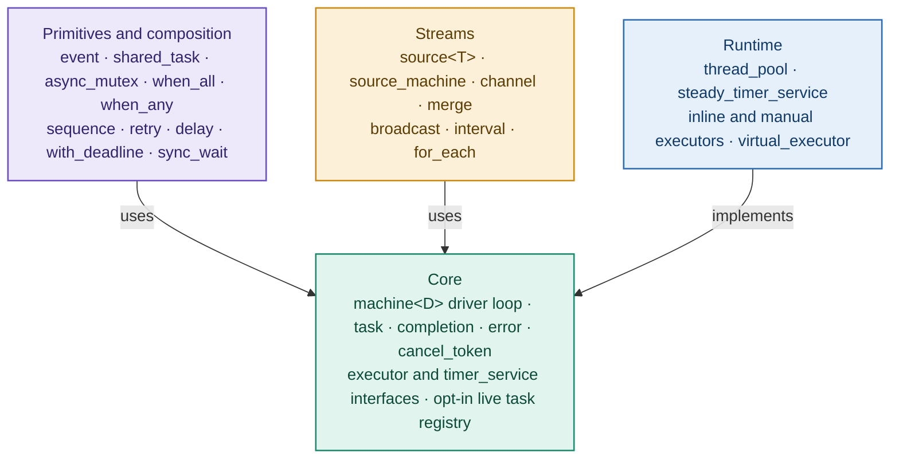

# stepwright overview

## What stepwright is

stepwright is a header-only C++20 library for writing asynchronous operations as
explicit state machines. An operation is a class; each *step* is an ordinary
member function that returns a *transition* saying what happens next. A small
*driver loop* in the base class carries the transitions out.

For a complete first program, see the [README](../README.md), then
[the first machine example](../examples/01_first_machine.cpp). The
[user guide](guide.md) explains the contracts and [design notes](design/engine.md)
explain the implementation and memory-ordering arguments.

It is aimed at systems code (storage, networking, schedulers, embedded
runtimes) that needs predictable performance, explicit control flow that is
easy to debug, and no hidden allocations, and that either cannot or prefers
not to use C++20 coroutines.

### How it compares
- **C++20 coroutines:** convenient, but frame allocation, lifetime and
  cancellation are implicit. stepwright's state lives in plain members, you can
  inspect it in a debugger, and it never allocates per step.
- **Senders/receivers (P2300):** very general and composable, but heavy on
  templates. stepwright is deliberately small, with one execution model.
- **Callback chains / `std::function`:** easy to start with, but they grow
  into nested lambdas, allocate, and make error handling ad hoc. stepwright
  keeps the same "callback" efficiency with structure.

## Design principles

1. **Zero allocation on hot paths.** No heap allocation per step, per child
   wait, per park/wake, per deferral, or per primitive wait (waiter nodes are
   embedded in the waiting object). Error paths are hot paths too: library
   control-flow errors (cancellation, timeouts, closes) without a message
   never allocate, and other errors with short messages reuse per-thread
   recycled storage, so they are allocation-free in steady state.
2. **Static dispatch.** Step functions are template arguments
   (member-function pointers); no virtual call or `std::function` per step.
3. **Stack safety by construction.** Back-to-back steps and synchronously
   completing children are run by a loop, never by recursion, in every build
   mode, without relying on tail-call optimisation.
4. **Explicit threading model.** A machine continues on the thread that
   delivered its result, unless it is bound to a home executor, in which
   case continuations are posted there. The invariant that matters is
   exclusivity (one thread runs a machine's steps at a time), not thread
   identity.
5. **Structured cancellation.** Every start carries a cancel token; machines
   pass it to their children automatically; waiters unregister on cancel.
6. **Errors are values.** `stepwright::error` is a cheap, copyable handle around
   a `std::error_code`, a message and automatically added context frames
   (which machine the error passed through). Exceptions are not used as an
   error channel.
7. **Safe completion discipline.** Never start a child, fire a completion or
   call user code while holding an internal lock; never touch an object
   after delivering its completion (the receiver may destroy it).
8. **Same layout in every build.** Debug checks never change class layout.
9. **Every bug gets a regression test; every performance claim gets a fair,
   reproducible benchmark.**

## Architecture

Primitives, composition and streams are built on the core; the runtime implements
the core's executor and timer interfaces:

### Core vocabulary
- **task**: anything that can be started with a completion target and a
  cancel token, and completes exactly once (synchronously or later, on any
  thread).
- **machine<D>**: CRTP base for tasks written as steps. Entry step: `begin()`.
- **Transitions:** `done()`, `fail(e)`, `then<&D::f>()` (next step, same
  loop), `after<&D::f>(child)` (start a child, continue with its result),
  `forward(child)` (finish with the child's result), `park<&D::f>()` (wait for
  an external `wake(e)`), `defer<&D::f>()` (continue later on the home
  executor).
- **completion**: a function pointer plus context, called with
  `const error&`.

## Public roadmap

v0.2 contains the machine engine and errors-as-values, structured cancellation,
events, shared tasks, asynchronous mutexes, fan-out joins and deadlines; pull
streams with bounded channels, merging and broadcasting; inline/manual and
work-stealing executors, manual/steady timers, a deterministic virtual executor
and an opt-in live task registry. It includes runnable examples, reproducible
benchmarks, design arguments and installable CMake/pkg-config packages. v0.2 adds
`sync_wait`, `virtual_executor::run`, `sequence`, `retry`, joins over containers
and reusable operations, which make everyday code shorter. v0.2.1 makes error
paths (timeouts, cancellations, failures with short messages) allocation-free in
steady state.

Possible future directions include a C++20 coroutine adapter, more executor and
event-loop adapters, Windows support, and vcpkg/Conan packages. These are directions,
not scheduled commitments. Compatibility within the 0.x series is minor-version
scoped; check the changelog before upgrading.

## Non-goals
- Requiring coroutines (a coroutine adapter may come later).
- Windows support.
- I/O, networking or OS event loops (stepwright composes them; it doesn't
  provide them).
- Exceptions as the error channel.

## Platforms
macOS (AppleClang 16 or newer, native builds) and Linux (GCC 13 or newer,
Clang 18 or newer, libstdc++ or libc++, x86-64 and arm64). Linux development
and validation run in the dev container, including GCC 14 and Clang 20.
